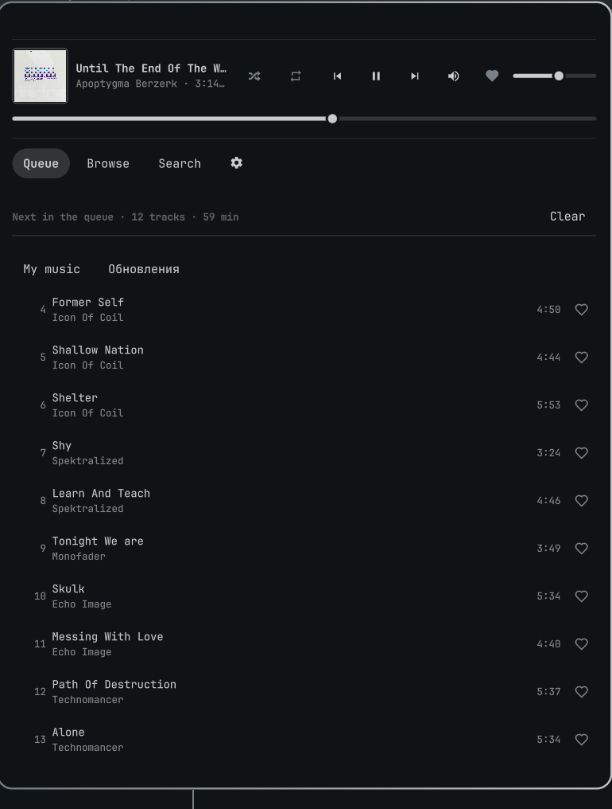
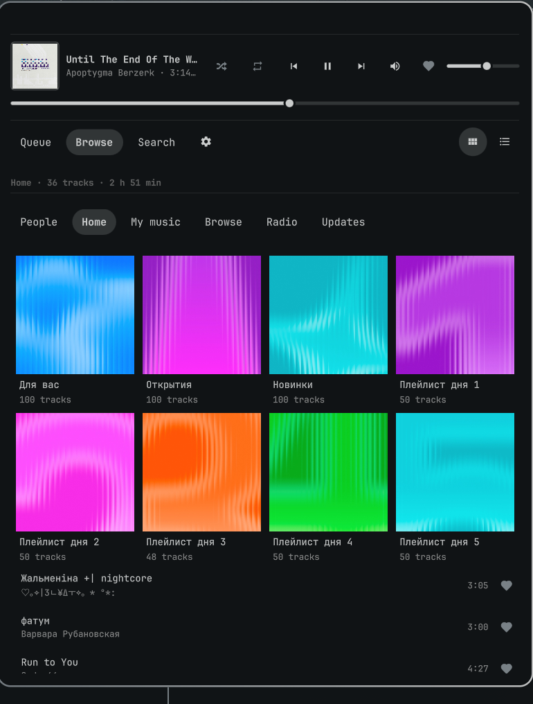
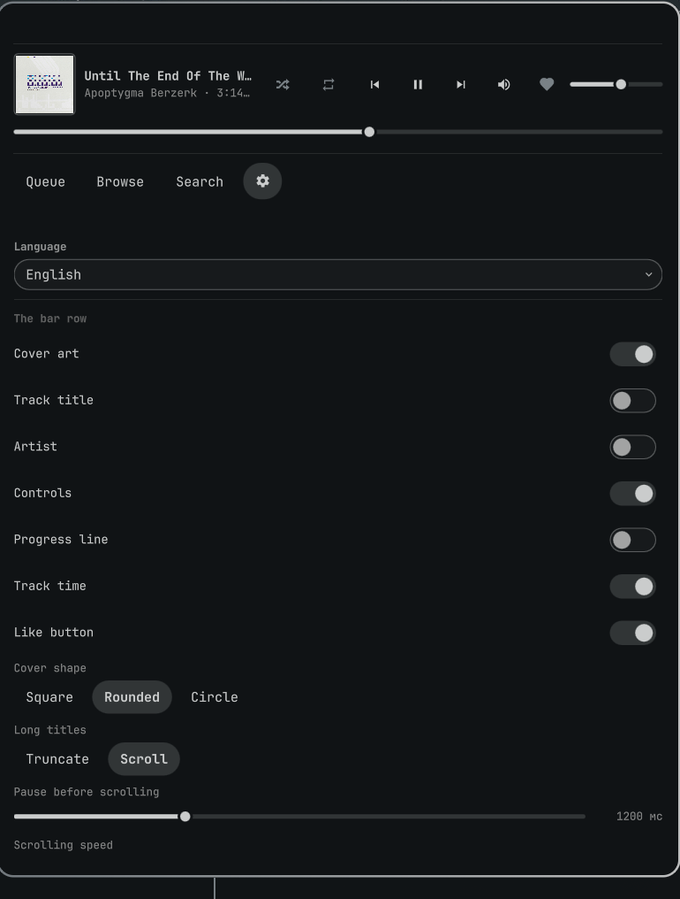

# VK Music для Omarchy

**[English version](README.md)** · Русский

VK Music в баре Omarchy: обложка, название и управление в самом баре, а в панели —
очередь, «Моя музыка», чужие плейлисты и радио. Воспроизведение идёт через mpv, поэтому
мультимедийные клавиши и любой MPRIS-клиент работают без дополнительной настройки.

| Очередь | Галерея | Настройки |
|---|---|---|
|  |  |  |

## Что умеет

- **Строка в баре** — обложка, название и исполнитель, назад / играть-пауза / вперёд,
  линия прогресса и кнопка «Нравится». Каждый элемент можно выключить, и выбор
  запоминается.
- **Очередь** — треки, которые ты запускал, по порядку. Можно перейти к любому, убрать его,
  а правый клик ставит трек следующим или в конец.
- **Своя музыка и каталог** — «Моя музыка», разделы, которые предлагает VK, и любой
  плейлист: галереей обложек или компактными строками, как удобнее.
- **Чужие плейлисты** — друзья, любой человек по ссылке и поиск плейлистов.
- **Радио** — станции, на которые ссылается VK, играют прямо со своих потоков.
- **Лайки** — сердечко в каждой строке и у плеера. На VK лайк и есть «Моя музыка», поэтому
  разойтись они не могут.
- **Поиск** — подсказки по мере ввода, результаты после паузы, треки или плейлисты.
- **Клавиатура** — `hjkl` или стрелки для движения, `Enter` — играть, `/` — фильтр по
  открытому списку, `m` — галерея или список, `[`/`]` — вкладки, `⇧H`/`⇧L` — разделы.
- **Восемь языков** — английский (по умолчанию), немецкий, испанский, французский,
  японский, китайский, украинский и русский. Переключается в настройках.

## Что нужно

```bash
omarchy pkg add python mpv ffmpeg
```

## Установка

Добавление плагина лишь кладёт виджет на место. Бэкенд — служба на Python со своим
виртуальным окружением — ставится **вторым шагом**, потому что плагин не должен запускать
установщик просто от того, что его включили:

```bash
omarchy plugin add https://github.com/vyorkin/omarchy-vk-music --enable
cd ~/.config/omarchy/plugins/vyorkin.vk-music
./install.sh --backend-only
```

Вторая команда собирает бэкенд в `~/.local/share/omarchy-vk-music`, ставит
пользовательский systemd-сервис и запускает его. Без неё панель откроется пустой, а бар
скажет, что служба не запущена. После правок бэкенда — та же команда.

## Вход в VK

Публичного OAuth для аудио у VK нет, поэтому основной путь делает то же, что браузер:
берёт cookie `p` и `remixsid` из профиля браузера и меняет их на токен. Пароль не
спрашивается и нигде не хранится. Путь по паролю ниже его спрашивает, держит только в
памяти сервиса до ответа VK и никогда не записывает на диск.

1. Войди на <https://vk.ru> в Firefox, Zen или LibreWolf.
2. Открой панель и нажми **Войти через браузер** либо выполни
   `omarchy-vk-music auth web` в терминале.
3. Сессия живёт, пока её не завершит VK: «Завершить все сессии» в настройках VK выключит и
   плагин.

### Несколько аккаунтов

Панель хранит столько аккаунтов VK, сколько ты в неё добавил. У каждого своя очередь,
позиция, лайки и недавние запросы. Настройки интерфейса и громкость общие: они относятся к
панели и динамикам, а не к аккаунту.

- **Настройки → Аккаунты** перечисляет сохранённые аккаунты. Активный помечен; другой
  включается в один клик, со своей очередью на той же позиции и на паузе.
- **Добавить аккаунт** предлагает браузерный путь (сессия, в которой сейчас сидит
  Firefox, Zen или LibreWolf) и вход по логину и паролю с кодом из SMS или приложения.
  Именно второй путь позволяет завести второй аккаунт, не выходя из первого в браузере.
- **Удалить** забывает аккаунт, его токен, очередь и лайки. Удаление активного передаёт
  сессию следующему сохранённому, удаление последнего возвращает экран входа.

Добавление и переключение останавливают воспроизведение: выданный URL потока принадлежит
старой сессии, а треки старой очереди — не очередь нового аккаунта. Те же действия из
терминала: `omarchy-vk-music accounts`, `account switch <id>`, `account remove <id>`.

Токены и cookie лежат в `~/.config/omarchy-vk-music/accounts.json` с правами 600 и не
попадают ни в репозиторий, ни в журнал.

## Управление

| Где | Что |
|---|---|
| Бар, левый клик | открыть панель |
| Бар, правый клик | пауза или продолжить |
| Бар, средний клик | следующий трек |
| Бар, колесо | громкость |
| `Space` | пауза |
| `j` `k` / `↑` `↓` | движение курсора |
| `h` `l` | влево-вправо в галерее |
| `Enter` | играть выбранное |
| `/` | фильтр по открытому списку |
| `m` | галерея или список |
| `[` `]` | предыдущая / следующая вкладка |
| `⇧H` `⇧L` | предыдущий / следующий раздел |
| `Tab` | из поля в список |
| `Esc` | на шаг назад |
| `Backspace` | на уровень назад |

## Терминал

```bash
omarchy-vk-music status                 # что играет, длина очереди, настройки
omarchy-vk-music play section all       # начать с «Моей музыки»
omarchy-vk-music search radiohead       # найти и напечатать треки
omarchy-vk-music play search radiohead  # играть результаты
omarchy-vk-music next
omarchy-vk-music volume 60
omarchy-vk-music queue remove 3
omarchy-vk-music prefs language=ru
omarchy-vk-music auth status
omarchy-vk-music accounts
omarchy-vk-music account switch 213706100
omarchy-vk-music account remove 213706100
```

Каждая команда печатает одну строку JSON; `--pretty` её форматирует.

## Если что-то не так

```bash
systemctl --user status omarchy-vk-music
journalctl --user -u omarchy-vk-music -f
omarchy-vk-music auth status
```

Плагин **останавливается**, а не повторяет попытки, когда VK просит капчу или включает
ограничение запросов. Это сделано намеренно: долбить неофициальный эндпоинт — так и
блокируют аккаунты. Подожди и перезапусти сервис либо войди заново.

Если виджет пропал из бара — `omarchy restart shell`, затем
`omarchy plugin enable vyorkin.vk-music --after omarchy.clock`.

## Где что лежит

| Путь | Что |
|---|---|
| `~/.config/omarchy-vk-music/accounts.json` | токены и cookie всех аккаунтов, активный, права 600 |
| `~/.config/omarchy-vk-music/state.json` | очередь, позиция, лайки и история по аккаунтам; громкость и настройки общие |
| `~/.cache/omarchy-vk-music/audio` | скачанные треки, по умолчанию 256 МиБ |

## Удаление

```bash
./uninstall.sh           # вход и настройки остаются
./uninstall.sh --purge   # удаляется и это
```

## Правовая сторона

Аудио-API VK неофициальный и недокументированный. Плагин пользуется им так же, как
мобильный клиент: одно постоянное «лицо», размеренные запросы, никакого парсинга
страниц, — но риск для аккаунта всё равно твой. Ничего не скачивается и не раздаётся:
кеш существует, чтобы перемотка уже играющего трека была мгновенной.

## Благодарности

- Иконки [Lucide](https://lucide.dev), лицензия ISC, лежат в `LucideIcons.js`.
- [vornashev/omarchy-yandex-music](https://github.com/vornashev/omarchy-yandex-music) —
  структура (Python-бэкенд, mpv через сокет, MPRIS, панель на QML) повторяет его.

Лицензия MIT.
